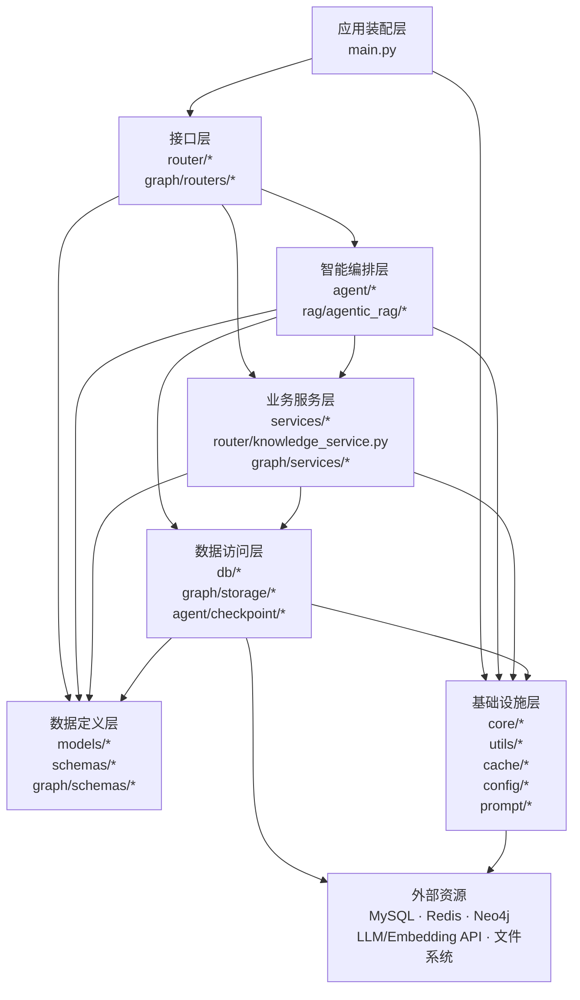

# 后端学习笔记

## 1. 总体架构

```
前端 React
    │ HTTP / SSE
    ▼
FastAPI 路由层
    ├── 用户、笔记、复习
    ├── 知识库上传
    ├── 图谱查询
    └── Agent 对话
          │
          ▼
Agentic RAG 前置检索
    规划 → 本地检索 → 可答性判断 → 联网兜底 → 证据融合
          │
          ▼
LangGraph Agent
    上下文注入 → 工具调用 → 人工审批 → 流式回答
          │
          ├── MySQL：业务数据、会话、Checkpoint、任务状态
          ├── Neo4j：Chunk、向量索引、全文索引、实体关系
          ├── Redis：鉴权缓存、Token 黑名单、限流
          └── 文件系统：MD5记录、文档图片、媒体文件
```

应用总入口是`main,py`，它完成：

- 注册所有 FastAPI 路由。
- 初始化 MySQL 表和会话管理器。
- 连接 Redis。
- 后台初始化模型、Neo4j Schema、图谱 Worker。
- 关闭时释放 Redis、Neo4j 和 MySQL 连接。


建议学习顺序：

1. `main.py`: 理解应用生命周期。
2. `chat.py`: 抓住主请求入口。
3. `agentic_rag/service.py`: 掌握RAG编排。
4. `local_retriever.py`: 理解实际检索来源。
5. `neo4j_graph_store.py`: 理解混合检索。
6. `agent.py`: 理解Agent流式执行。
7. `graph_service.py`: 理解数据如何进入Neo4j。
8. 最后再看笔记、认证、复习等普通业务模块。

## 2. 后端架构

```
backend/
├── main.py                         # FastAPI应用入口、路由装配、启动/关闭生命周期
├── pyproject.toml                  # Python依赖与项目配置
├── uv.lock                         # uv锁定依赖版本
├── Dockerfile                     # 后端容器构建
├── openapi.json                    # 导出的API定义
├── .env / .env.example             # 环境变量
│
├── app/
│   ├── router/                     # HTTP接口层
│   │   ├── chat.py                 # Agent对话、SSE、审批恢复、会话接口
│   │   ├── chat_service.py         # 会话与重排序适配
│   │   ├── knowledge_router.py     # 知识库上传、查询、删除接口
│   │   ├── knowledge_service.py    # 上传校验、切片调度、SSE进度
│   │   ├── note_router.py          # 笔记CRUD、搜索、写作辅助
│   │   ├── note_template_router.py # 笔记模板接口
│   │   ├── review_router.py        # 间隔复习接口
│   │   ├── user.py                 # 用户、认证、文件接口
│   │   └── health.py               # 存活和就绪检查
│   │
│   ├── agent/                      # LangGraph Agent编排层
│   │   ├── agent.py                # Agent创建、执行、流式输出、暂停与恢复
│   │   ├── agent_tools.py          # 笔记、复习、时间等Agent工具
│   │   ├── agent_rag_tool.py       # Agent补充RAG检索工具及防重复护栏
│   │   ├── agent_middleware.py     # 重试、限次、监控、人工审批中间件
│   │   └── checkpoint/
│   │       └── mysql_saver.py      # LangGraph状态持久化到MySQL
│   │
│   ├── rag/                        # RAG能力层
│   │   ├── agentic_rag/
│   │   │   ├── service.py          # Agentic RAG总编排器
│   │   │   ├── planner.py          # LLM检索规划与规则降级
│   │   │   ├── local_retriever.py  # 本地文档、笔记、图谱检索
│   │   │   ├── evaluator.py        # 本地证据可答性判断
│   │   │   ├── web_search.py       # 联网检索兜底
│   │   │   ├── evidence.py         # 证据合并、去重、上下文格式化
│   │   │   ├── query_entity_extractor.py
│   │   │   │                       # 查询中的实体候选抽取
│   │   │   └── schemas.py          # 检索计划、证据、结果模型
│   │   │
│   │   ├── document_handler/
│   │   │   └── processor.py        # 多格式文档解析、切片、入队
│   │   ├── md5_manager/
│   │   │   └── md5_store.py        # 上传文档MD5去重记录
│   │   ├── vector_store.py         # 文档服务；实际Chunk存储已迁至Neo4j
│   │   ├── text_spliter.py         # 文本切片
│   │   ├── reorder_service.py      # 云端重排序
│   │   ├── task_queue.py           # 上传切片阶段的线程安全队列
│   │   └── sse_models.py           # 上传进度SSE事件模型
│   │
│   ├── graph/                      # 知识图谱与Neo4j检索子系统
│   │   ├── routers/
│   │   │   └── graph_router.py     # 图谱查询、编辑、重抽取、事件接口
│   │   ├── services/
│   │   │   ├── graph_service.py    # 图谱构建、任务入队、抽取与清理
│   │   │   ├── graph_worker.py     # 后台任务轮询与消费
│   │   │   └── event_bus.py        # 图谱构建事件推送
│   │   ├── extraction/
│   │   │   ├── entity_extractor.py # 使用LLM抽取实体和关系
│   │   │   ├── chunk_matcher.py    # 实体与Chunk规则匹配
│   │   │   └── link_parser.py      # 解析笔记Wiki双链
│   │   ├── storage/
│   │   │   ├── graph_store.py      # 图存储抽象接口
│   │   │   ├── neo4j_graph_store.py
│   │   │   │                       # Neo4j实现、向量+全文混合检索
│   │   │   └── neo4j_client.py     # Neo4j连接与索引初始化
│   │   └── schemas/
│   │       └── graph.py            # 图谱实体、关系、视图、Chunk命中模型
│   │
│   ├── services/                   # 普通业务服务层
│   │   ├── note_service.py         # 笔记CRUD、搜索、标签、关联推荐
│   │   ├── note_template_service.py
│   │   ├── review_service.py       # 间隔复习业务
│   │   └── database_session_manager.py
│   │                               # 对话历史和pending run管理
│   │
│   ├── models/                     # SQLAlchemy ORM模型
│   │   ├── user_model.py           # 用户
│   │   ├── note.py                 # 笔记
│   │   ├── note_template.py        # 笔记模板
│   │   ├── review_record.py        # 复习记录
│   │   ├── chat_history.py         # 会话、消息及共享Base
│   │   ├── agent_checkpoint.py     # LangGraph checkpoint
│   │   └── graph.py                # 图谱任务、日志、文档注册等MySQL模型
│   │
│   ├── schemas/                    # API请求/响应模型
│   │   ├── models.py               # 对话、知识库、笔记模型
│   │   └── user_schemas.py         # 用户和认证模型
│   │
│   ├── db/                         # 数据库连接层
│   │   ├── db_config.py            # MySQL引擎、Session、建表和简单迁移
│   │   └── redis_config.py         # Redis连接池和缓存操作
│   │
│   ├── cache/
│   │   └── redis_decorator.py      # Redis缓存装饰器
│   │
│   ├── core/                       # 全局基础设施
│   │   ├── settings.py             # 环境变量配置
│   │   ├── background_init.py      # 模型、Neo4j、Worker后台初始化
│   │   ├── rate_limit.py           # Redis限流
│   │   ├── logger_handler.py       # 日志
│   │   ├── success_response.py     # 统一成功响应
│   │   ├── failed_response.py      # 统一错误响应
│   │   └── failed_response_register.py
│   │                               # FastAPI异常处理器注册
│   │
│   ├── utils/                      # 通用技术工具
│   │   ├── factory.py              # Chat/Embedding/Vision模型工厂
│   │   ├── auth_utils.py           # JWT、密码、当前用户解析
│   │   ├── prompt_loader.py        # Prompt加载
│   │   ├── config.py
│   │   ├── config_handler.py       # YAML配置加载
│   │   ├── file_handler.py         # 文件加载与MD5
│   │   ├── pdf_multimodal_loader.py
│   │   ├── vision_service.py       # PDF图片理解
│   │   ├── image_extractor.py      # PDF图片提取与清理
│   │   ├── input_sanitizer.py
│   │   └── path_tool.py
│   │
│   ├── prompt/                     # LLM提示词
│   │   ├── main_prompt.md
│   │   ├── rag_context_prompt.md
│   │   ├── agentic_rag_planner.md
│   │   ├── agentic_rag_answerability.md
│   │   ├── entity_extraction_prompt.md
│   │   ├── query_entity_extraction.md
│   │   ├── auto_tag_prompt.md
│   │   ├── autocomplete_prompt.md
│   │   ├── write_assistant_prompt.md
│   │   └── ...
│   │
│   └── config/                     # YAML配置
│       ├── document.yaml            # 切片大小、重叠、文件类型
│       ├── prompt.yaml              # Prompt名称到文件映射
│       ├── rag.yaml                 # 已废弃，模型配置迁至.env
│       └── agent.yaml
│
├── scripts/                        # 数据修复、回填和评测脚本
│   ├── backfill_graph.py
│   ├── check_graph_data.py
│   ├── eval_recall.py
│   ├── eval_end2end.py
│   └── ...
│
├── tests/                          # 自动化测试
│   ├── agent/
│   ├── rag/
│   ├── graph/
│   ├── services/
│   └── test_*.py
│
├── results/                        # RAG与图谱评测结果
└── media/                          # 用户头像等媒体文件
```


整体分层如下：




各层职责如下：

| 层         | 主要职责                         | 不应承担的职责   |
| ---------- | -------------------------------- | ---------------- |
| 应用装配层 | 注册路由、管理启动和关闭         | 具体业务逻辑     |
| 接口层     | 参数接收、认证、限流、响应转换   | 复杂检索和持久化 |
| 智能编排层 | RAG规划、Agent循环、工具调用     | 直接处理HTTP细节 |
| 业务服务层 | 笔记、知识库、图谱任务等业务规则 | FastAPI响应格式  |
| 数据访问层 | MySQL、Redis、Neo4j读写          | 业务决策         |
| 数据定义层 | ORM和Pydantic模型                | 流程编排         |
| 基础设施层 | 配置、日志、模型工厂、文件处理   | 领域业务规则     |

存在少量跨层访问，例如：

- `chat.py` 直接调用 `AgenticRagService` 和 Agent。
- `graph_router.py` 直接获取 `GraphStore`。
- `NoteService` 同时访问MySQL和Neo4j。
- `knowledge_service.py` 位于 `router/`，但实际属于业务服务层。


先掌握三条主链：

- 对话链
- 文档入库链
- 笔记链


## 3. `main.py`

完成三件事：

1. 创建并配置 FastAPI 应用。
2. 管理一次请求的公共处理流程。
3. 管理整个应用的启动与关闭生命周期。

完整周期

```
启动 uvicorn
    ↓
导入 main.py
    ↓
创建 FastAPI app
    ↓
注册中间件、路由、静态目录、异常处理器
    ↓
执行 startup_event
    ├── 初始化 MySQL
    ├── 创建测试用户
    ├── 初始化会话管理器
    ├── 连接 Redis
    └── 启动后台资源初始化
    ↓
开始接受 HTTP 请求
    ↓
请求经过中间件
    ↓
进入具体路由
    ↓
响应再次经过中间件
    ↓
返回客户端
    ↓
应用停止
    ↓
执行 shutdown_event
    ├── 关闭 Redis
    ├── 停止图谱 Worker
    ├── 关闭 Neo4j
    └── 关闭 MySQL 连接池
```

初次不理解的地方已经在注释中注明，下面解释异步思想的应用。

如何理解异步？

——当一个任务正在等待数据库、网络或模型响应时，先把执行机会让给其他任务。

假设我们要查询一个数据库，花费2s。如果我们用异步写法：

异步写法：

```py
result = await query_database()
```

当请求A等待数据库时，事件循环可以去处理请求B：

```
请求A发送数据库请求
    ↓
A进入等待，交出执行权
    ↓
事件循环处理请求B
    ↓
数据库返回A的结果
    ↓
事件循环恢复请求A
```

因此它适合：

- 数据库查询
- Redis操作
- Neo4j查询
- 调用LLM API
- 联网搜索
- 文件异步读写
- SSE流式输出

这些操作的共同特点是大量时间花在“等待外部系统”。


**小结：**

`main.py`负责装配应用和管理生命周期，不承载业务逻辑。

`@app.middleware("http")`包裹每一个HTTP请求，可以在路由执行前后做公共处理。

`@app.on_event("startup")`在服务接收请求前执行初始化。

`@app.on_event("shutdown")`在服务退出前释放资源。

`async def`表示函数可以被事件循环调度。

`await`表示等待结果，同时允许事件循环处理其他任务。

`create_task()`表示把工作放到后台执行，当前流程不等待它完成。

项目的异步主要用于数据库、Redis、Neo4j、LLM调用、SSE和后台Worker。

`await init_manager.start()`只等待后台任务被创建，不代表模型已经全部初始化完成。

异步提高的是I/O等待期间的并发能力，不会让CPU计算本身自动变快。